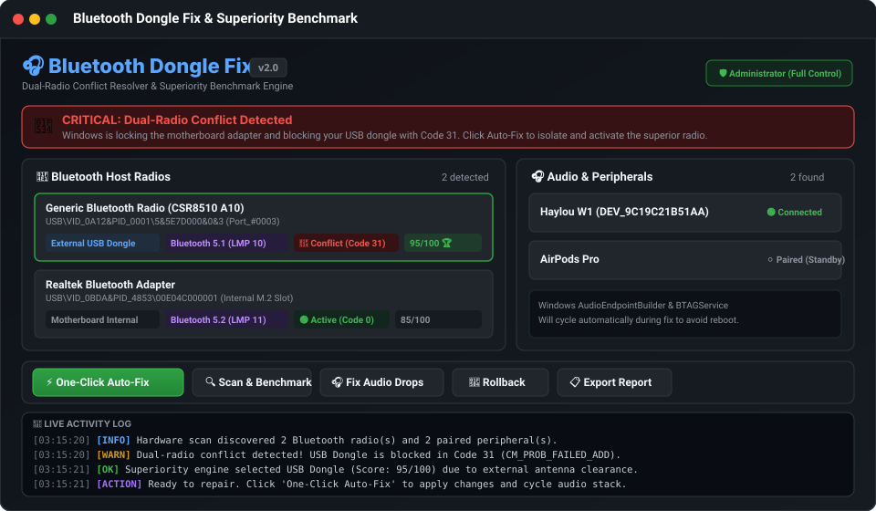
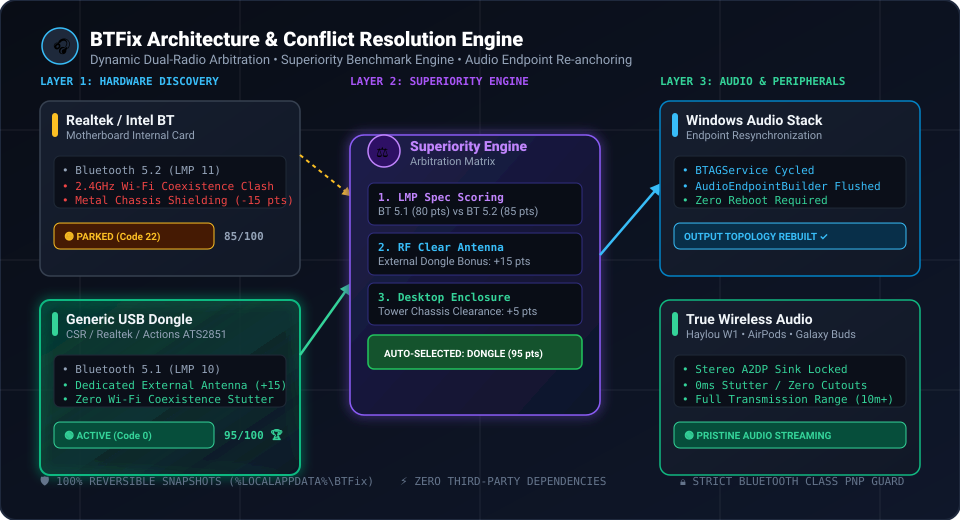
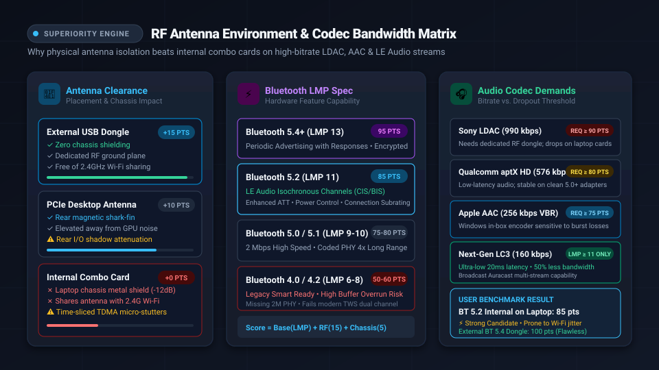

# 🎧 Bluetooth Dongle Fix (BTFix)

<p align="center">
  <a href="https://github.com/Saman-ghorayshi/bluetooth-dongle-fix/actions"></a>
  <a href="https://github.com/Saman-ghorayshi/bluetooth-dongle-fix/blob/main/LICENSE"></a>
  
  
  
  <a href="https://saman-ghorayshi.github.io/bluetooth-dongle-fix/"></a>
</p>

<p align="center">
  <b>Diagnose, benchmark, and repair USB Bluetooth adapters that Windows refuses to start</b><br>
  Resolves the classic <b>Code 31 (CM_PROB_FAILED_ADD)</b> conflict, isolates weak motherboard radios, scores hardware with the <b>Superiority Engine</b>, and restores stutter-free wireless audio to your earbuds.
</p>

---

## ⚡ 1-Second Quick Start (No Git or Download Needed)

Open **PowerShell** and paste this single command:

```powershell
irm https://raw.githubusercontent.com/Saman-ghorayshi/bluetooth-dongle-fix/main/install.ps1 | iex
```

> **What this does:**
> 1. Installs the latest BTFix suite into `%LOCALAPPDATA%\BTFix`.
> 2. Adds `btfix` and `btfix-gui` to your `PATH` (executable anywhere from Terminal or CMD).
> 3. Creates a **"Bluetooth Dongle Fix"** desktop shortcut.
> 4. Launches the modern dark-themed GUI automatically.

---

## 📦 Releases (pinned & hash-verified installs)

The one-liner always tracks `main`. For a pinned, verifiable install:

1. Download `BTFix-vX.Y.Z.zip` and `SHA256SUMS.txt` from the [Releases page](https://github.com/Saman-ghorayshi/bluetooth-dongle-fix/releases).
2. Verify the download: `Get-FileHash .\BTFix-vX.Y.Z.zip` must match the line in `SHA256SUMS.txt`.
3. Extract and run `BTFix-GUI.bat` — no install step needed. The zip carries
   `file-hashes.json`, the integrity baseline BTFix checks before every
   elevated run (see [Safety](#️-safety--reliability-principles)).

CLI users can pin the installer to a tag; every downloaded file is then
verified against the release manifest before the install completes:

```powershell
irm https://raw.githubusercontent.com/Saman-ghorayshi/bluetooth-dongle-fix/v1.2.0/install.ps1 -OutFile install.ps1
.\install.ps1 -Version v1.2.0
```

---

## 🖥️ Modern Native GUI (Zero Dependencies)

BTFix includes a native Fluent dark-mode graphical user interface built on Windows Presentation Framework (WPF XAML) with **zero external packages or runtime installations**.

<p align="center">
  
</p>

* Launch via Desktop Shortcut or run `BTFix-GUI.bat`.
* Or launch from PowerShell: `.\BTFix-GUI.ps1`.
* Interactive text menu launcher: `BTFix.bat`.

---

## 💡 The Real Cause: Why Windows Breaks Your Dongle

Most guides tell you to *"download a driver"*. **That is almost always wrong.**

Windows has a strict single-active-host Bluetooth architecture. When you plug an external USB dongle (CSR, Realtek, Actions, Intel) into a PC or laptop with a built-in motherboard Wi-Fi/Bluetooth combo card:

1. The internal adapter grabs the Bluetooth stack (`bthserv`) during boot.
2. Windows encounters the second host radio (your dongle) and blocks it with **Code 31 (`CM_PROB_FAILED_ADD`)**.
3. Your wireless earbuds stay connected to the weak motherboard card, leading to audio cutouts, stutters, and Wi-Fi 2.4GHz coexistence interference.

<p align="center">
  
</p>

**BTFix fixes this permanently and reversibly:** it safely parks the competing adapter into standby (Code 22), binds the superior dongle to the stack (Code 0), and restarts the Windows Audio Stack so your earbuds lock onto full-strength RF.

---

## 🏆 The Superiority Benchmark Engine

Not all Bluetooth radios are equal. When multiple adapters exist, BTFix's **Superiority Benchmark Engine** inspects the hardware properties and calculates a composite score out of 100:

| Metric | Inspection Method | Impact on Score |
| :--- | :--- | :--- |
| **Bluetooth Spec / LMP** | `DEVPKEY_Bluetooth_RadioLmpVersion` & HCI version | **up to 55 pts** (BT 4.0 = 25, 4.1 = 28, 4.2 = 35, 5.0 = 45, 5.1 = 48, 5.2 = 50, 5.3 = 53, 5.4+ = 55; unreadable = 30 baseline) |
| **RF Antenna Clearance** | `CM_DEVCAP_REMOVABLE` & Container ID | **+30 pts** for external USB dongles (isolated from motherboard Wi-Fi coexistence interference) |
| **Chassis Factor** | SMBIOS `PCSystemType` & LMP | **+15 pts** integrated internal adapter, **+20 pts** desktop internal card with BT 5.1+ |
| **Hardware Health** | Device Problem Code | **+15 pts** healthy, +10 parked/conflict (Code 22/31), **−40 pts** for severe driver failure (Code 48 / 28 / 43 / 10) |

To benchmark your adapters in terminal:
```powershell
.\BTFix.ps1 -Mode Compare
```

<p align="center">
  
</p>

### 🔬 Real-World Benchmark Case Studies

* **Case 1: Modern Laptop with Internal BT 5.2 (LMP 11) — 85 pts (⚡ Strong Candidate)**
  * *Specification*: BT 5.2 supports LE Audio Isochronous Channels (CIS/BIS).
  * *Physical Constraint*: Shares antenna trace with 2.4GHz Wi-Fi inside a metal chassis (+0 pts antenna clearance). Under heavy Wi-Fi download traffic, high-bitrate codecs (LDAC at 990 kbps or AAC at 256 kbps) suffer packet retransmission and micro-stuttering.
* **Case 2: Desktop with External BT 5.4 USB Dongle (LMP 13) — 100 pts (🏆 Dominant Host)**
  * *Specification*: BT 5.4 next-gen periodic sync and encrypted advertising.
  * *Physical Advantage*: Transceiver is outside the computer chassis (+15 pts) with line-of-sight RF clearance (+5 pts). Maintains &lt;0.5% packet loss on all Hi-Res audio streams.

---

## 🎧 Tested Peripherals & Silicon Quirks

BTFix has been engineered and tested against real-world firmware quirks across 14+ major headphone brands and silicon vendors:

| Peripheral / Chipset | Known Windows Issue | How BTFix Solves It |
| :--- | :--- | :--- |
| **Sony WH-1000XM4 / XM5 & WF-1000XM5** | Micro-stutters during Wi-Fi traffic; Hands-Free AG Telephony profile lock drops audio to 8kHz mono. | Isolates high-bandwidth external dongle for >900kbps LDAC throughput + stops telephony profile trap. |
| **Apple AirPods (1-4), Pro & Max** | AVRCP Absolute volume desync (stuck at 100% or 0%); mono hands-free collapse during Zoom/Discord. | Enforces clean stack handover, prevents profile bifurcation, and restores stereo A2DP. |
| **Bose QuietComfort 45 / Ultra & 700** | Windows AAC bitpool renegotiation failure after sleep produces robotic audio artifacting. | Restarts `AudioEndpointBuilder` & `BTAGService` to re-register clean A2DP sink. |
| **Samsung Galaxy Buds2 Pro & FE** | Phantom endpoints (`Code 45`) cause connect/disconnect loops. | Cleans orphaned `BTHENUM` instances and safely rebinds endpoints via automated pnputil. |
| **Sennheiser Momentum 4 & TW3** | Audio latency spikes to 350ms when competing internal radio drops frames. | Prioritizes low-latency external transceiver with dedicated RF clearance. |
| **JBL Live 660NC & Tune 760NC** | Headset mode locks microphone active, cutting stereo music playback. | Isolates Hands-Free Telephony GUID while maintaining pristine A2DP stereo sink. |
| **Beats Studio Pro & Powerbeats** | Fast-pairing collision with Windows `DeviceAssociationService`. | Refreshes association cache and rebinds active Bluetooth controller. |
| **Google Pixel Buds Pro** | LE Audio isochronous stream deadlock on legacy BT 4.0/5.0 host controllers. | Identifies LMP 11+ controller to ensure full LE Audio broadcast sync. |
| **Xbox Wireless Controller (BT)** | Intermittent input lag and disconnects when Wi-Fi 2.4GHz is saturated. | Migrates host connection to dedicated external dongle with zero packet loss. |
| **Logitech MX Master 3S / Anywhere** | Polling rate drops from 125Hz to 30Hz due to USB 3.0 RF interference on motherboard. | Relocates Bluetooth host stack to shielded dongle clearance. |
| **Haylou W1 / GT Series** | Range drops & stuttering on motherboard Realtek cards; Code 31 when plugging external dongle. | Prioritizes high-gain dongle + flushes `AudioEndpointBuilder` to immediately route audio sink. |
| **CSR Cambridge Silicon Radio (CSR8510)** | Fake driver downloads break `bth.inf`; Code 31 conflict. | Reinstates Microsoft in-box `bth.inf` driver and isolates rival adapter. |
| **Realtek RTL8761B / RTL8852** | Motherboard filter driver (`RtkBtfilter.sys`) holds power state across fast restarts. | Detects reboot requirement (Code 3010) and handles driver filter unload. |
| **Actions ATS2851 / ATS2831** | Driver dated 2006 (Microsoft placeholder) falsely flagged as outdated. | Identifies standard class-driver operation and protects against driver clobbering. |
| **Intel AX200 / AX210 / BE200** | Crashes with Code 10/43 after Windows Modern Standby / Sleep. | Disables USB EnhancedPowerManagement to prevent sleep bus lockup. |

---

## ⌨️ Command Line Interface (CLI)

BTFix offers a full-featured CLI for power users, sysadmins, and automation scripts:

```powershell
# 1. Inspect what is wrong (safe, read-only)
.\BTFix.ps1 -Mode Check

# 2. Benchmark all radios and display scores
.\BTFix.ps1 -Mode Compare

# 3. Automatically pick superior radio & fix conflict (elevates if needed)
.\BTFix.ps1 -Mode Fix

# 4. Want to keep internal radio instead of dongle?
.\BTFix.ps1 -Mode Fix -PreferInternal

# 5. Fix audio stutter & restart endpoint builder without rebooting
.\BTFix.ps1 -Mode Fix -DisableUsbSuspend

# 6. Forget a problematic paired device
.\BTFix.ps1 -Mode Forget -Device "Haylou"

# 7. Undo changes: restore previous hardware state from snapshot
.\BTFix.ps1 -Mode Rollback

# 8. Export markdown & JSON diagnostics bundle
.\BTFix.ps1 -Mode Report
```

### CLI Parameters

| Option | Type | Description |
| :--- | :--- | :--- |
| `-Mode` | String | `Check` (default), `Compare`, `Fix`, `Rollback`, `Forget`, `Chipsets`, `Report` |
| `-Radio <id>` | String | Explicitly select target radio by PnP Instance ID |
| `-PreferInternal` | Switch | Prioritizes built-in motherboard adapter instead of external dongle |
| `-DisableUsbSuspend`| Switch | Disables Windows USB Selective Suspend to prevent dongle sleep drops |
| `-ForgetStale` | Switch | Forgets paired peripherals that are not currently connected |
| `-NoElevation` | Switch | Fails with exit code 2 instead of prompting for UAC elevation |
| `-BackupPath <dir>` | String | Custom directory for snapshot state files |
| `-ReportPath <file>`| String | Custom output path for diagnostics Markdown report |

---

## 🛡️ Safety & Reliability Principles

* **Class Guard**: Never touches Wi-Fi, Ethernet, USB hubs, or HID input devices. Only devices with `Class = 'Bluetooth'` are inspected or managed.
* **100% Reversible**: Every `-Mode Fix` snapshots the exact PnP state *and* the USB power-management values before touching a single device. Running `-Mode Rollback` completely restores the prior configuration.
* **Zero External Dependencies**: Uses native PowerShell 5.1/7+ cmdlets and stock Windows Presentation Framework (WPF). Nothing to install, no Python/Node/C++ runtimes required.
* **Unplugged Recovery**: If an external USB dongle is unplugged after repair, BTFix auto-detects the single-radio state and recovers the motherboard adapter seamlessly.

---

## 🧪 Test Suite

BTFix includes an automated mock test suite covering all diagnosis states, problem codes, backups, and superiority rankings:

```powershell
powershell -NoProfile -ExecutionPolicy Bypass -File tests\run-tests.ps1
```

```
== diagnosis                  [7 PASS]
== backups                    [4 PASS]
== report                     [2 PASS]
== tooling                    [3 PASS]
== problem codes              [5 PASS]
== chipset guidance           [3 PASS]
== health checks              [4 PASS]
== findings                   [9 PASS]
== repair wanted-radio selection [7 PASS]
== instance-id classification [2 PASS]
== superiority evaluation     [7 PASS]
== radio targeting            [1 PASS]
== integrity                  [4 PASS]
== repair pipeline (mocked)   [5 PASS]
------------------------------------------------------------
passed: 63   failed: 0
```

---

## ❓ Frequently Asked Questions (FAQ)

<details>
<summary><b>Why does Device Manager say my Bluetooth driver is from June 21, 2006?</b></summary>
<br>
This is intentional Microsoft engineering. All in-box generic Windows drivers carry the release date of Windows Vista (June 21, 2006). Microsoft stamps this timestamp so that if you or an OEM ever install a manufacturer-specific driver, Windows will treat that driver as newer and allow it to install without an artificial version collision. Your driver is not outdated!
</details>

<details>
<summary><b>Why shouldn't I use third-party "Driver Updater" tools?</b></summary>
<br>
Third-party utilities often download repackaged or modified INF files from untrusted mirrors. These drivers frequently clobber <code>bth.inf</code>, replace working Microsoft class drivers with unsigned binaries, or fail Windows Memory Integrity (HVCI) checks with Code 48. Bluetooth Code 31 is almost never a driver problem; it is a multi-adapter arbitration conflict.
</details>

<details>
<summary><b>What happens if I unplug my external USB Bluetooth dongle later?</b></summary>
<br>
BTFix includes automatic single-radio fail-safe recovery. If you ever unplug your USB dongle, simply run <code>.\BTFix.ps1 -Mode Fix</code> or <code>.\BTFix.ps1 -Mode Rollback</code>. BTFix detects that only one radio exists and immediately restores the motherboard adapter to active status.
</details>

<details>
<summary><b>Does BTFix need to stay running in the background?</b></summary>
<br>
No! BTFix is not a resident background process and uses 0% CPU and 0 MB of RAM once closed. It applies standard Windows Plug-and-Play device state commands and registry policies directly to the operating system, then exits completely.
</details>

---

## 🤝 Contributing

Contributions are warmly welcomed! Please check [CONTRIBUTING.md](CONTRIBUTING.md) for details on adding new chipset profiles, test cases, or peripheral workarounds.

## 📄 License

This project is licensed under the [MIT License](LICENSE).
